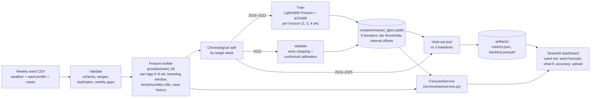

# Moshari architecture

Moshari forecasts dengue cases for each of 60 city wards 2, 3 and 4 weeks ahead. It turns those forecasts into Low, Medium, High or Critical risk with a response for each tier. Everything runs locally from a saved model, so there are no API calls at forecast time.

## Data flow

Code layout: `src/moshari/` holds the engine (`data`, `features`, `model`, `risk`, `evaluation`, `training`, `service`). `ui/` holds the dashboard only. The dashboard never touches LightGBM directly; it calls `ForecastService`, which a FastAPI layer can wrap unchanged in the final sprint.

## The breeding clock, as features

Rain does not cause cases the next day. Water pools, Aedes larvae take 7 to 14 days to mature, and symptoms follow incubation. Measured inside each ward, rainfall correlates with cases most strongly **3 weeks later (r = 0.75)**, compared with 0.53 for same-week rain. All features are computed within `groupby(ward_id)` and look only backwards from the issue week *t*:

| Group | Features |
|---|---|
| Rainfall | weekly lags 0–8, rolling sums over 2/4/8 weeks, `rain_breeding_window` (lags 2–4), count of heavy-rain weeks |
| Temperature, humidity | 2- and 4-week means, value 3 weeks ago, day–night range |
| Ward vulnerability | density, water-logging, sanitation, composite index, city corporation |
| Recent transmission | cases this week, 1 and 2 weeks ago, 4-week mean, 2-week trend |
| Seasonality | week of year as sine and cosine |

The target for horizon *h* is cases at *t + h*. Unit tests check that lags never cross ward boundaries and that changing a future week leaves every earlier feature unchanged.

## Chronological validation

The split is by the **week being forecast**, never random: train on 2016–2022, validate on 2023, test on 2024–2025.

1. Fit on train and early-stop on 2023 to choose boosting rounds.
2. Calibrate the 80% range on 2023 with conformalized quantile regression, which widens or narrows the q10–q90 band until it covers 80% of that year.
3. Refit on 2016–2023 with those rounds. This is the shipped model.
4. Score once on 2024–2025, which the model never saw.

Results on the hold-out (6,300 ward-weeks per horizon; MAE and RMSE in cases per ward per week):

| Horizon | MAE | RMSE | Baseline: this week | Baseline: last year | Baseline: seasonal avg | Tier accuracy | High-risk recall | 80% range coverage |
|---|---|---|---|---|---|---|---|---|
| 2 weeks | **1.01** | 2.05 | 1.66 | 1.69 | 1.24 | 83% | 69% | 82% |
| 3 weeks | **1.03** | 2.03 | 1.87 | 1.69 | 1.24 | 83% | 71% | 80% |
| 4 weeks | **1.19** | 2.33 | 2.06 | 1.69 | 1.24 | 81% | 70% | 85% |

The dashboard runs replays inside 2024–25 using this same model, so every forecast shown there is out-of-sample. `python scripts/train.py --production` refits on all years for a live deployment.

## Model choice

**LightGBM gradient-boosted trees, one model per horizon, with a Poisson objective**, plus two quantile models per horizon for the 80% range.

- The data is small and tabular (31k rows, 33 features). Boosted trees beat neural nets in this setting and need little tuning.
- Cases are non-negative counts with many zeros, so a Poisson objective fits better than squared error.
- Separate models per horizon (direct forecasting) avoid the error compounding of feeding forecasts back in as inputs.
- Explanations are exact and free: LightGBM computes TreeSHAP natively (`pred_contrib=True`), so no extra library is needed. In log space the contributions add up exactly to the prediction, which a test verifies. The UI shows them as multipliers ("rainfall ×4.5").
- Tiers use fixed thresholds from training-year case quantiles (P70, P85, P95, which are 2, 7 and 13 cases a week). They are stored in the bundle, so tiers mean the same thing everywhere.

## Compute and API cost controls

| Control | Where | Effect |
|---|---|---|
| Zero runtime API calls | whole app | Forecasts, explanations and what-ifs run on the local CPU. No paid weather API and no LLM, so token cost is 0 by design. |
| Serialized model | `models/moshari_lgbm.joblib` | Training (about 60 s on a laptop CPU) happens once. Startup only loads a 6.5 MB file. Boosters are stored in LightGBM's text format inside joblib, so they load across library versions. |
| Process-wide model cache | `st.cache_resource` | The model and feature table load once per server, shared across users. |
| Input-keyed result cache | `st.cache_data` on (data fingerprint, week, horizon, cities) | Repeated views are served from memory. A new upload changes the fingerprint and invalidates only its own entries. |
| Vectorised inference | `ForecastService` | All 60 wards in about 0.1 s; a 30-week by 60-ward season heatmap in about 0.3 s. |
| One-shot data fetch | `scripts/fetch_data.py` | The dataset is committed. Refreshing it is one validated HTTP GET with no key. |
| Validation before compute | `data.validate` | Bad uploads are rejected before any feature or model work runs. |

If the final sprint adds live weather or an LLM summary, the same pattern applies: fetch once per ward per day into a disk cache keyed by date, batch all wards into a single request, and cap LLM output tokens, with the cached template text as the fallback.
