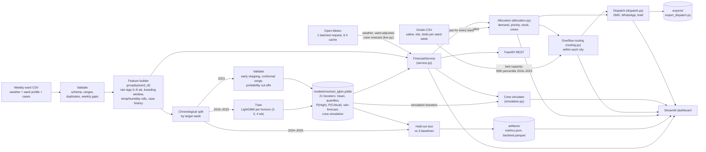

# Moshari architecture

Moshari forecasts dengue cases for each of 60 city wards 2, 3 and 4 weeks ahead and turns them into Low, Medium, High or Critical risk, each with a response. Phase 2 turns those forecasts into operations: supplies and spraying crews under scarcity, hospital overflow within each city, the effect of extra crews, and the notices officers receive. Everything runs locally from a saved model; the only runtime API call is one cached Open-Meteo request for the Live outlook, and `MOSHARI_OFFLINE=1` switches even that off.

## Data flow

`src/moshari/` holds the engine (`data`, `features`, `model`, `risk`, `evaluation`, `training`, `service`, `live`, and for Phase 2 `allocation`, `routing`, `simulation`, `dispatch`, `dispatch_pdf`); `ui/` holds the dashboard only. Neither the dashboard nor the API touches LightGBM directly. Both call `ForecastService`, so a fix reaches both at once.

## The breeding clock, as features

Larvae take 7 to 14 days to mature and symptoms follow incubation, so within each ward rainfall correlates with cases most strongly **3 weeks later (r = 0.75)**, against 0.53 for same-week rain. All features are computed within `groupby(ward_id)` and look only backwards from the issue week *t*; the target for horizon *h* is cases at *t + h*. Tests check that lags never cross wards and that changing a future week leaves earlier features unchanged.

| Group | Features |
|---|---|
| Rainfall | lags 0–8 weeks, 2/4/8-week sums, `rain_breeding_window` (lags 2–4), heavy-rain weeks |
| Temperature, humidity | 2- and 4-week means, value 3 weeks ago, day–night range |
| Ward vulnerability | density, water-logging, sanitation, composite index, city corporation |
| Recent transmission | cases this week, 1 and 2 weeks ago, 4-week mean, 2-week trend |
| Seasonality | week of year as sine and cosine |

## Chronological validation

Split by the **week being forecast**, never at random: train 2016–2022, validate 2023, test 2024–2025. 2023 chooses boosting rounds, calibrates the 80% range (conformalized quantile regression) and tunes probability cut-offs; the shipped model is then refit on 2016–2023 and scored once on 2024–25. Dashboard replays of 2024–25 are therefore out-of-sample. `scripts/train.py --production` refits on all years for deployment.

| Horizon | MAE | RMSE | This week | Last year | Seasonal avg | Tier accuracy | 80% coverage |
|---|---|---|---|---|---|---|---|
| 2 weeks | **1.01** | 2.05 | 1.66 | 1.69 | 1.24 | 83% | 82% |
| 3 weeks | **1.03** | 2.03 | 1.87 | 1.69 | 1.24 | 83% | 80% |
| 4 weeks | **1.19** | 2.33 | 2.06 | 1.69 | 1.24 | 81% | 85% |

MAE and RMSE are in cases per ward per week over 6,300 hold-out ward-weeks per horizon; the three middle columns are baseline MAEs.

## Model choice

**LightGBM, one set of models per horizon.** A Poisson model gives expected cases, two quantile models the 80% range, and two binary models the chance of reaching High and Critical.

- Small tabular data (31k rows, 33 features): boosted trees beat neural nets here with little tuning.
- Counts with many zeros suit a Poisson objective better than squared error.
- Direct per-horizon models avoid compounding errors from feeding forecasts back in.
- Explanations are exact and free: LightGBM's native TreeSHAP (`pred_contrib=True`) adds up to the prediction in log space (tested), shown as multipliers such as "rainfall ×4.5".
- Tier thresholds come from training-year quantiles (2, 7 and 13 cases a week) and are stored in the bundle.

## Peaks, alerts and the rain forecast

**Outbreak probability.** Expected cases smooth over peaks (about 4 cases low on actual Critical weeks). Peak-weighting, isotonic or power calibration and Tweedie all raised average error by 10–20%, so instead the binary models estimate P(Critical); a ward goes on **Critical watch** past a cut-off tuned on 2023. Critical weeks caught rise from **24/28/20% to 63/70/73%** at 2/3/4 weeks (AUC 0.96/0.95/0.92), at the cost of more false alarms (about two in three flags at 3 weeks stay below Critical).

**Alert sensitivity.** Who goes on the watch list is a separate, switchable rule (3-week horizon):

| Rule | Alerts when | High-risk weeks caught | Alerts that were real | Alerted by season onset |
|---|---|---|---|---|
| Standard | expected cases reach High | 71% | 67% | 35% |
| Balanced | midpoint of expected and upper bound | 87% | 59% | 57% |
| **Cautious (default)** | upper end of the 80% range | **98%** | 49% | **90%** |

Missing an outbreak costs more than an extra larviciding visit, so Cautious is the default.

**Rain forecast.** Cases 4 weeks out depend on next week's rain, which hasn't fallen at issue time, so stacking, seasonal priors and bigger models barely helped. Forecast-assisted models also see the next two weeks of weather, trained with noise (rain ±65%, temperature ±1 °C) so they don't over-trust it. 4-week MAE drops from **1.19 to 1.08** with a realistic forecast (1.07 with a perfect one; seasonal average 1.24). Live mode feeds them Open-Meteo's forecast; replays keep the base model, as past forecasts aren't archived.

## Phase 2: from forecast to operations

All four modules are plain pandas on top of `ForecastService`, with no network or LLM calls. They are deterministic: the same week and settings always give the same plan.

**Demand ratios** (`allocation.py`). The onsite dataset, `data/raw/dengue_onsite.csv`, has the same 31,320 ward-weeks plus three demand columns. Demand per case is fitted from it by least squares through the origin:

| Supply | Per expected case | R² |
|---|---|---|
| Saline bags | 2.384 | 0.9997 |
| Diagnostic kits | 1.158 | 0.9988 |
| Hospital beds | 0.295 | 0.9804 |

Demand is rounded up, so it is never understated. The ratios are refitted from the file the first time they are needed, with fallbacks of 2.39, 1.16 and 0.30 if the file is missing.

**Priority and scarcity.** `priority_score = 100 × (0.6 × tier/3 + 0.4 × P(High)) × (0.5 + 0.5 × density / max density)`. Risk sets most of the order, and density moves a ward within it: the densest ward keeps its full risk score, the sparsest keeps half. Stock, set at 30–100% of total demand, goes to wards in priority order until it runs out. Any ward that gets less than 100% is flagged with its shortfall. High and Critical wards need one spraying crew per 5 expected cases, and each of them gets one crew, in priority order, before any ward gets a second.

**Overflow routing** (`routing.py`). The data has no bed-capacity column, so a ward's capacity is its 90th-percentile weekly `hospital_beds_required` over 2016–2023, rounded up and at least 1. That gives 1 to 5 beds per ward, against 4 to 12 in each ward's peak week. Each city corporation is routed separately. Wards over capacity send patients, largest overflow first, to the least loaded ward that has spare beds (ties go to the nearest ward number, then the ward id). Routing stops when the overflow is placed or the city runs out of beds, and anything left is reported as unplaced. Patients never cross cities. Property tests on 150 random three-city weeks check this, check that patients are conserved, and check that no ward stays over capacity while its city has spare beds.

**Crew simulator** (`simulation.py`). A crew removes breeding sites, so in the model it removes a share of the ward's recent breeding signal: rain 0–4 weeks back, the breeding window and heavy-rain weeks. The share is `effect(c) = min(0.75, 1 − (1 − 0.20)^c)` for `c` crews. One crew removes 20%, each extra crew helps less, and no amount of spraying removes more than 75%. Older rain has already produced its mosquitoes and is left alone. A separate LightGBM model per horizon re-scores the changed features. It has monotone constraints on rain, so a crew can never raise a forecast. Its hold-out MAE is 1.00, 1.06 and 1.23 at 2, 3 and 4 weeks, against 1.01, 1.03 and 1.19 for the main model. Only its proportional reduction is applied to the main forecast, so baselines match the rest of the app. The 20% is an assumption, not a measurement, because the data has no spraying records, so the Simulator page lets officers set it anywhere from 10% to 35%. Crews are placed greedily, each one where it prevents the most extra cases, and a crew that would prevent fewer than 0.1 cases is held back.

**Dispatch** (`dispatch.py`, `dispatch_pdf.py`). String templates turn one row of allocation and routing into three formats. The SMS always fits one 160-character segment: optional details are dropped in a fixed order, never the risk, supplies or deficit. The other two are a WhatsApp message and a one-page A4 commissioner brief in HTML, and reportlab draws the same brief as a PDF. `scripts/export_dispatch.py` writes the demo week into `exports/`.

## Offline design

| Part | Offline behaviour |
|---|---|
| Forecasts, allocation, routing, simulation, dispatch | Local model and pandas only; they never use the network |
| Live outlook | `MOSHARI_OFFLINE=1` or the sidebar **Offline mode** toggle skips Open-Meteo and serves the last cached weather. If nothing is cached, the page shows a clear message |
| Fonts | Google Fonts fall back to system fonts |
| Proof | `tests/test_offline.py` blocks sockets, renders all 9 pages, runs the core pipeline and checks the weather cache |

## Compute and API cost controls

| Control | Effect |
|---|---|
| Local inference, no LLM | Forecasts, explanations and what-ifs run on the CPU; token cost is 0. |
| One batched, cached weather call (`live.py`) | All 5 cities in **one** Open-Meteo request, cached on disk for 6 h, manual refresh limited to once per 10 min, last good response used offline. |
| Serialized model | Training (about 2 min) happens once; startup loads an 11.3 MB joblib file with boosters in LightGBM's portable text format. |
| Caching | Model and features load once per server (`st.cache_resource`); results are keyed by data fingerprint, week, horizon and cities (`st.cache_data`); the API has an `lru_cache`. |
| Fast paths | All 60 wards in about 0.1 s; what-if sliders re-run only their card (`st.fragment`); the dashboard skips importing scikit-learn, cutting cold start from 12.4 s to 8.1 s. |
| Validation first | Bad uploads are rejected before any feature or model work. |

An LLM summary in the final round would follow the same pattern: one batched request, a disk cache keyed by date, capped output tokens, and a cached template as fallback.

## Limitations

- Weekly data, so forecasts update weekly; no ward coordinates, so the dashboard uses a schematic ward net, not a map.
- Expected cases understate peaks; the outbreak-probability models above compensate.
- Live mode has no reported cases yet: recent case history is a weather-driven nowcast from the model's own 2-week forecasts.
- Live weather is one point per city corporation, adjusted per ward. In the training data wards differ from their city by about 1% in rain and under 0.1 °C, so little is lost.
