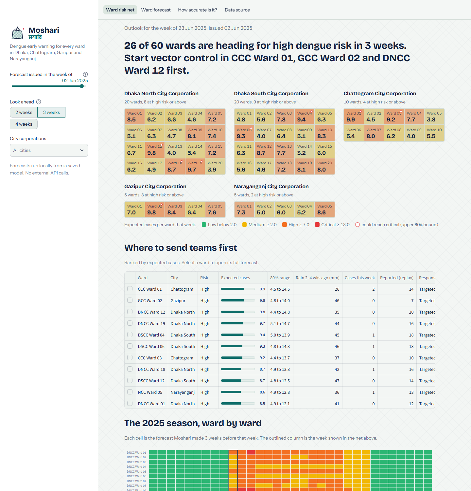
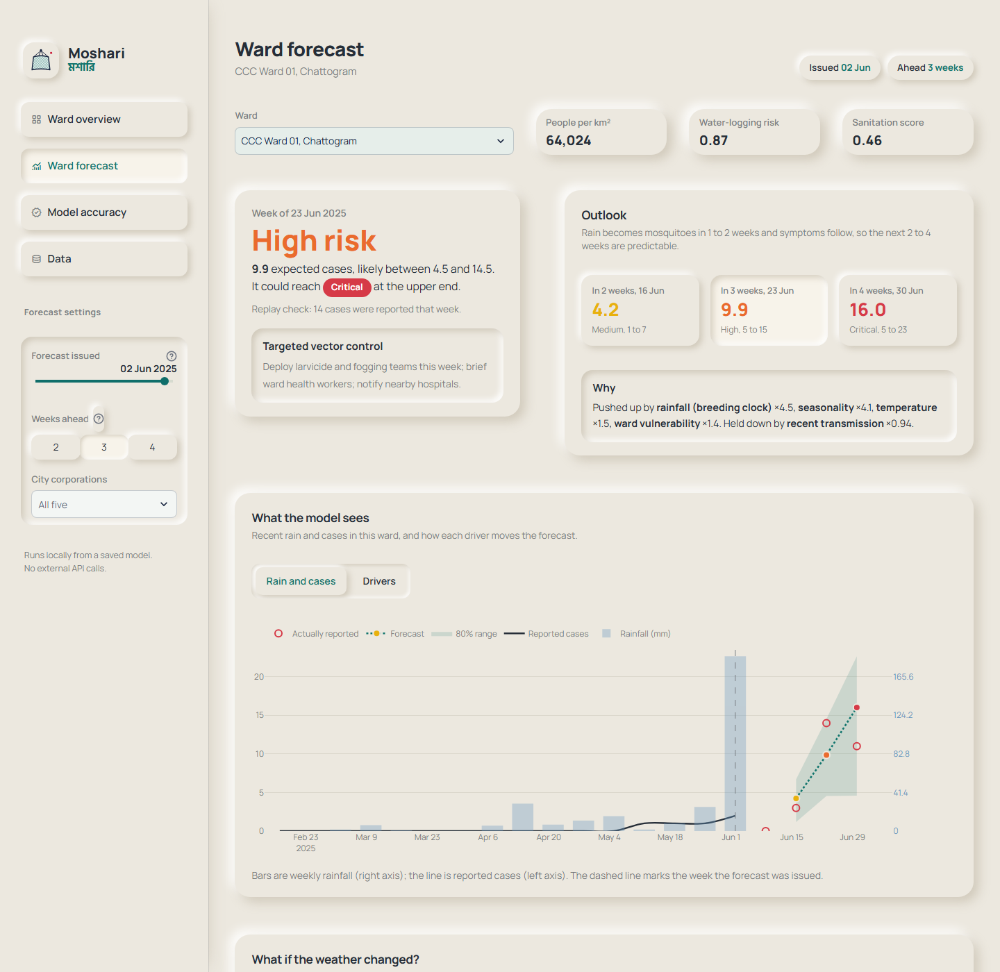
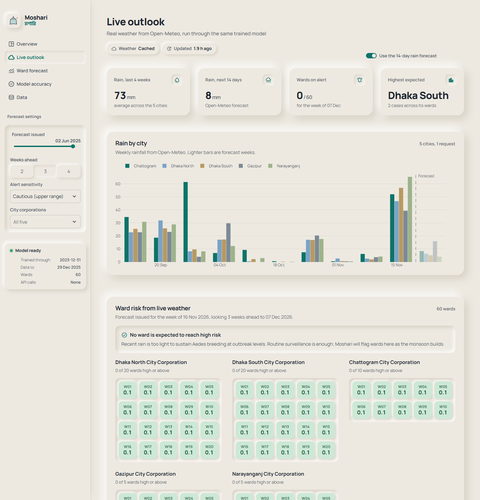

<p align="center">
  
</p>

<h1 align="center">Moshari (মশারি)</h1>

<p align="center"><b>Ward-level dengue early warning for Dhaka, Chattogram, Gazipur and Narayanganj.</b></p>

*Moshari* is Bangla for mosquito net. A net protects one family. Moshari helps protect whole wards by forecasting dengue cases **2 to 4 weeks ahead** from weather. That gives city corporations time to send larvicide and fogging teams *before* hospital admissions climb.

## Results at a glance

Tested on 2024 and 2025, two seasons the model never saw during training (3-week forecasts, 6,300 ward-weeks):

| | Result |
|---|---|
| Average miss | **1.03 cases** per ward per week |
| Against the best simple rule | **17% lower error** |
| Right risk tier | **83%** of ward-weeks |
| 80% forecast range | covers **80%** of actual counts |
| High-risk weeks caught (cautious alerts) | **98%** |
| Critical weeks caught (outbreak probability) | **70%**, up from 28% using expected cases |
| 4-week error with Open-Meteo rain forecast | **9% lower** (1.19 to 1.08 cases) |
| Alert out before the season's first high-risk week | **90%** of ward-seasons, against 35% for a plain threshold |
| Setup time with uv | **56 s** from a cold start |

**Try it live:** https://moshari-sa5dxzxydg98ej4umhvbst.streamlit.app/ (free hosting sleeps when idle; the first visit can take about 30 seconds to wake)

**Demo video (3 min):** https://youtu.be/tghizcy3_V8

[](https://youtu.be/tghizcy3_V8)



## Run it locally

Needs Python 3.10 or newer and git. The trained model and the dataset are in the repo, so the only download is the Python packages.

### Fastest: with uv (about 1 minute)

[uv](https://docs.astral.sh/uv/) installs the same packages as pip, much faster. A cold install with no cache took **56 seconds** here, against **6 min 11 s** for plain pip.

**Windows (PowerShell)**

```powershell
git clone https://github.com/yasinDoc/moshari.git
cd moshari
python -m pip install uv
python -m uv venv .venv
python -m uv pip install --python .venv -r requirements.txt
.venv\Scripts\streamlit run app.py
```

**macOS / Linux**

```bash
git clone https://github.com/yasinDoc/moshari.git
cd moshari
python3 -m pip install uv
python3 -m uv venv .venv
python3 -m uv pip install --python .venv -r requirements.txt
.venv/bin/streamlit run app.py
```

`--python .venv` makes uv install into the project's own environment, never your system Python. Or run the one-step script, which does the same thing: `powershell -ExecutionPolicy Bypass -File run.ps1` on Windows, `./run.sh` on macOS/Linux.

### With plain pip (slower, 2 to 8 minutes depending on your connection)

```powershell
python -m venv .venv
.venv\Scripts\activate          # macOS/Linux: source .venv/bin/activate
pip install -r requirements.txt
streamlit run app.py
```

The dashboard opens at http://localhost:8501.

## Tested on

| Operating system | Python | Installer | Setup time |
|---|---|---|---|
| Windows 10 Pro | 3.14.0 | uv, cold, no cache | 56 s |
| Windows 10 Pro | 3.14.0 | pip, cold, no cache | 6 min 11 s |
| Windows 11 Home Single Language | 3.15.2 | pip | 7 min 40 s |
| Windows 11 Pro 64-bit, Intel Celeron N4020 | 3.15.2 | pip | ran successfully |

Optional:

```bash
python scripts/train.py            # retrain and re-evaluate (about 2 minutes on a laptop CPU)
pip install -r requirements-dev.txt && pytest   # 976 tests
docker build -t moshari . && docker run -p 8501:8501 moshari
```

## What it does

| Page | What a health officer gets |
|---|---|
| **Overview** | Every ward's risk for the chosen week as tiles in a net, grouped by city corporation, plus a whole-season view. Wards on Critical watch, early alerts, the six wards to send teams to first, and risk by city. Click any ward to open its forecast. |
| **Live outlook** | Today's real weather from Open-Meteo (last 13 weeks plus a 14-day forecast) for every ward, with recent cases nowcast from that weather. The rain forecast feeds the 3- and 4-week outlook. One cached request for all five cities. |
| **Ward forecast** | One ward's 2-, 3- and 4-week outlook with an 80% range, the chance of reaching High and Critical, and the recommended response. A chart that lines up rain with later cases. The drivers behind the forecast, and what-if sliders for rain, temperature and humidity that re-run the model live. |
| **Model accuracy** | Hold-out results for 2024–25 against three simple baselines, a replay of both seasons, alert sensitivity, Critical weeks caught by probability, the gain from a rain forecast, and the evidence for the 3-week breeding lag. |
| **Data** | Upload a newer weekly CSV. It is validated, then every page forecasts from it. |





## REST API

The same forecasting service is available over HTTP for SMS alerts, hospital systems or a city GIS:

```bash
pip install -r requirements-api.txt
uvicorn moshari.api:app --app-dir src --port 8000   # interactive docs at http://localhost:8000/docs
```

| Endpoint | Returns |
|---|---|
| `GET /forecast?issue_date=2025-06-02&horizon=3&min_tier=High&city=Gazipur` | Ranked ward forecasts with 80% range, tier and response |
| `GET /wards/{ward_id}/outlook` | 2-, 3- and 4-week outlook for one ward |
| `GET /wards/{ward_id}/explain` | Driver multipliers behind a forecast |
| `POST /scenario` | What-if forecast with adjusted rain, temperature or humidity |
| `GET /health`, `GET /wards` | Model version, thresholds, ward profiles |

## How it works

1. **Validate** the weekly ward file: schema, plausible ranges, duplicates and gaps between weeks ([`data.py`](src/moshari/data.py)).
2. **Build lag features per ward**: rainfall 0–8 weeks back, the 2–4-week breeding window, temperature and humidity rolls, recent cases, ward vulnerability and season ([`features.py`](src/moshari/features.py)).
3. **Forecast** with LightGBM: a Poisson model per horizon for expected cases and quantile models for an 80% range calibrated with conformal prediction ([`model.py`](src/moshari/model.py)).
4. **Tier and respond**: Low, Medium, High or Critical from training-year thresholds, each with a response playbook ([`risk.py`](src/moshari/risk.py)). An **alert sensitivity** setting (Standard, Balanced, Cautious) decides which wards go on the watch list; the default Cautious rule catches 98% of high-risk weeks in the hold-out years.
5. **Explain**: TreeSHAP contributions computed natively by LightGBM, grouped into drivers like "Rainfall (breeding clock) ×4.5".
6. **Catch peaks and look further ahead**: separate models give the chance of reaching High and Critical (Critical weeks caught at 3 weeks: 28% → 70%), and forecast-assisted models use Open-Meteo's rain forecast in live mode (4-week error 9% lower).

On 2024–25, which the model never saw, 3-week forecasts are off by **1.03 cases per ward per week** on average. That is 17% better than the best baseline, with 83% of ward-weeks in the right tier. Full method, split and cost controls are in **[ARCHITECTURE.md](ARCHITECTURE.md)**.

## Project structure

```
moshari/
├── app.py                  # Streamlit entry point
├── run.ps1, run.sh         # one-step setup and launch
├── ui/                     # dashboard only: theme, components, cached state
│   └── views/              # ward_net, live, ward_forecast, model_check, data_source
├── src/moshari/            # forecasting engine, no UI code
│   ├── config.py           # paths, schema, horizons, split dates
│   ├── data.py             # ingestion + validation
│   ├── features.py         # per-ward lag features
│   ├── model.py            # LightGBM bundle, inference, TreeSHAP
│   ├── risk.py             # tiers + response playbook
│   ├── evaluation.py       # metrics + baselines
│   ├── training.py         # chronological training pipeline
│   ├── service.py          # ForecastService used by the UI and API
│   ├── live.py             # Open-Meteo weather, ward adjustment, case nowcast
│   └── api.py              # FastAPI REST layer
├── scripts/                # train.py, fetch_data.py
├── models/                 # serialized model bundle
├── artifacts/              # metrics.json, backtest.parquet
├── data/raw/dengue.csv     # challenge dataset
├── tests/                  # pytest suite
└── docs/                   # screenshots, demo script
```

## Team

Built by **Samiya**, **Ananya** and **Yasin** for the EDU AI Engineering Hackathon 2026, preliminary round (21 to 22 Nov 2026).

## AI assistants and external services

We disclose every AI tool and outside service used to build or run Moshari.

**AI assistants**

| Tool | Used for |
|---|---|
| Claude Code (Anthropic, model Claude Opus 5.5) | Pair-programming the pipeline, model, dashboard, tests and documentation; design review of the visual identity |
| GitHub Copilot (Microsoft, Copilot SDK in VS Code) | Code inspection and implementation support, test and environment validation, and documentation updates |

**External APIs and services**

| Service | When | Notes |
|---|---|---|
| Google Sheets CSV export | Once, to download the challenge dataset | `scripts/fetch_data.py`; the CSV is committed, so the app never calls it |
| Open-Meteo forecast API | Live outlook page only | One batched request for 5 cities, cached on disk for 6 hours, no key; the rest of the app works offline |
| Streamlit Community Cloud | Hosting the public demo | Free hosting of the same code from this repo; not needed to run locally |
| Google Fonts | When the dashboard loads in a browser | Manrope, Hind Siliguri; falls back to system fonts offline |

All forecasting runs locally and no LLM is used. The only runtime API is Open-Meteo on the Live outlook page: at most one request every 6 hours.

## Roadmap for the final round

- Connect live dengue case reports, so the Live outlook uses reported cases instead of a weather-driven nowcast.
- Add SMS alerts through the REST API for ward-level High and Critical forecasts.
- Replace the net-style ward display with a ward map using real ward boundaries and coordinates.

## License

MIT
