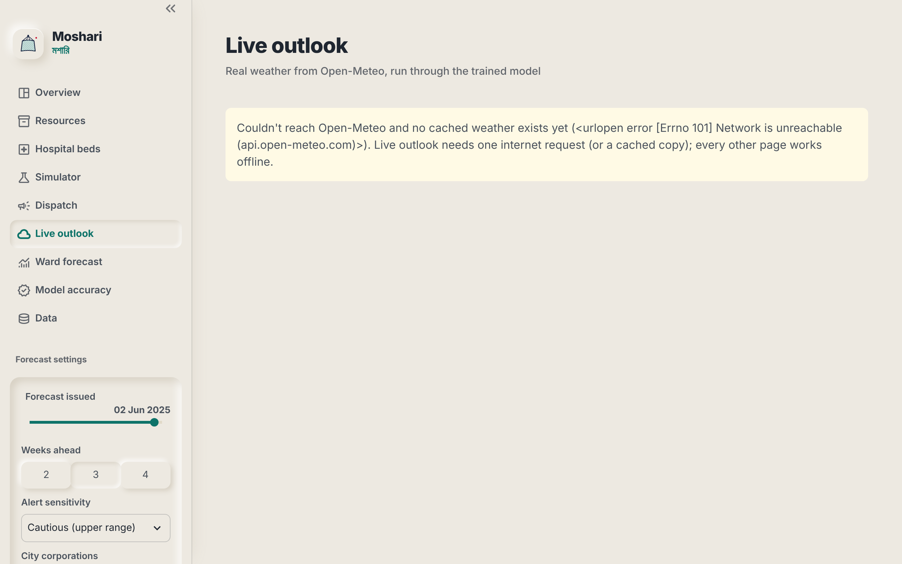
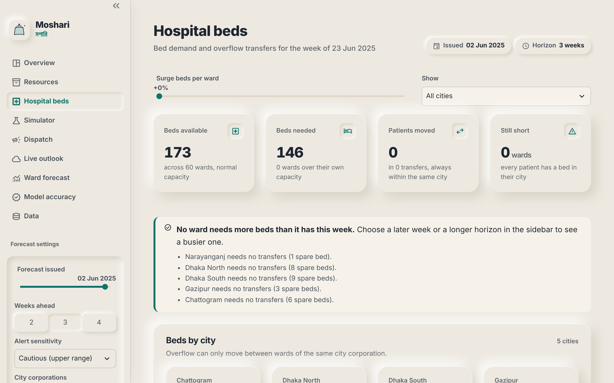
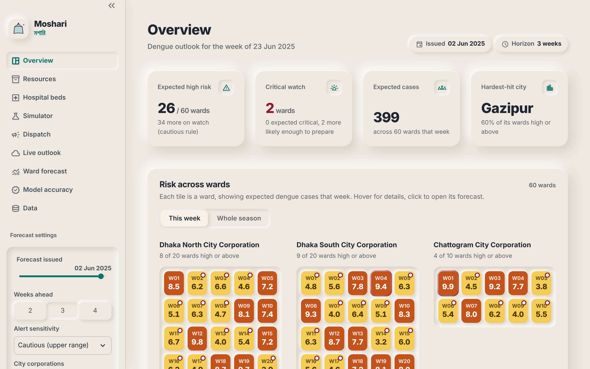

# Offline check (S3, module 5)

Moshari has to work on a laptop with no internet. This page shows how to prove it in front of
the judges, by hand (Wi-Fi off) and with one command, and records what we found.

**Result of the last run (2026-11-27):** all 10 pages work with Wi-Fi off. Nothing crashed. Only
Live outlook tries the internet: it asks Open-Meteo once, is refused, and shows a clear message
(or the last saved weather). The other 9 pages never try to go online.

## 1. By hand, in front of the judges (about 3 minutes)

Do this on the demo laptop (Windows).

1. **Before the demo, with internet on:** open the app once and visit **Live outlook**, so a copy
   of the weather is saved on the laptop. (Skip this to show the "no saved weather" message instead.)
2. **Close the app:** press `Ctrl+C` in the terminal that runs it, and close the browser tab.
3. **Turn Wi-Fi off:** click the Wi-Fi icon in the taskbar and switch Wi-Fi off. If the laptop has a
   network cable, unplug it too. Optional proof for the judges: open `https://google.com` in the
   browser and show that it fails.
4. **Start the app again** from the project folder:

   ```powershell
   .venv\Scripts\streamlit run app.py
   ```

   The browser opens `http://localhost:8501`. "localhost" is the laptop itself, so this needs no internet.
5. **Click through every page** in the sidebar and check each one against the table below.
6. **Optional, the kill switch:** in the sidebar, turn on **Offline mode**. Open Live outlook again: it now
   doesn't even try the internet, and shows "Offline mode" (or "Offline mode is on and no weather has
   been cached yet"). To start the whole app with the switch on, run
   `$env:MOSHARI_OFFLINE = "1"; .venv\Scripts\streamlit run app.py`.
7. Turn Wi-Fi back on when you're done.

| # | Page | What you should see with Wi-Fi off |
| --- | --- | --- |
| 1 | Overview | Ward risk tiles for the chosen week, as normal |
| 2 | Ward map | The 60 wards coloured by risk on real ward outlines (drawn from a file in the app, no map tiles); click a ward to open its forecast |
| 3 | Resources | Supplies, crews and deficits, as normal; the stock slider works |
| 4 | Hospital beds | Bed cards, transfers and the red "still short" list; the surge slider works |
| 5 | Simulator | Intervention plan and cases prevented, as normal |
| 6 | Dispatch | SMS and WhatsApp notices and the commissioner brief, as normal |
| 7 | Live outlook | With saved weather: the outlook, marked **Offline copy**. Without: a yellow message, "Couldn't reach Open-Meteo and no cached weather exists yet ... every other page works offline." No crash. |
| 8 | Ward forecast | One ward's forecast chart, as normal |
| 9 | Model accuracy | Back-test charts and metrics, as normal |
| 10 | Data | Dataset summary, as normal |

If any page shows a red error box, write down the page and the first line of the error and tell
Yasin straight away.

What it looks like with Wi-Fi off and no saved weather:



The other pages look exactly as they do online, for example:





## 2. With one command (about 10 seconds)

`scripts/offline_check.py` does the same check automatically, without turning off your Wi-Fi.
It cuts the internet for the app's own process only: every connection or DNS lookup to anything
other than this computer is refused, exactly as with Wi-Fi off, and proxy settings are ignored.

```powershell
.venv\Scripts\python scripts/offline_check.py            # Wi-Fi off, switch not set (the real case)
.venv\Scripts\python scripts/offline_check.py --switch   # Wi-Fi off and MOSHARI_OFFLINE=1
```

It starts the real app (`streamlit run app.py`) and waits for it to answer. Then it opens each of
the 10 pages, and fails if a page crashes or if any page other than Live outlook tries the internet.
Output from 2026-11-27:

```
Offline rehearsal (Wi-Fi off, offline switch not set)

PASS server booted offline, health ok in 1s
PASS Overview        OK 1.9s
PASS Ward map        OK 0.3s
PASS Resources       OK 0.3s
PASS Hospital beds   OK 0.4s
PASS Simulator       OK 0.4s
PASS Dispatch        OK 0.3s
PASS Live outlook    OK 0.3s - shows: Couldn't reach Open-Meteo and no cached weather exists yet (...) (asked Open-Meteo once, refused, handled)
PASS Ward forecast   OK 0.4s
PASS Model accuracy  OK 0.4s
PASS Data            OK 0.2s

OFFLINE CHECK: 10/10 pages OK, server booted, 7s
```

With `--switch`, the result is also 10/10, and Live outlook makes no network attempt at all.

## 3. In the test suite (runs on every push)

`tests/test_offline_wifi_off.py` (14 tests) keeps this true from now on:

- every one of the 10 pages renders with Wi-Fi off, and the 9 pages other than Live outlook make no
  network attempt;
- Live outlook with no saved weather shows its message instead of crashing;
- Live outlook with a 2-day-old saved copy still works and says "Offline copy";
- with `MOSHARI_OFFLINE=1`, Live outlook makes no network attempt, with or without saved weather.

`tests/test_offline.py` (Yasin's) checks the kill switch for the core pipeline and the pages.

## 4. Findings for Yasin

No crashes. Four small things, none blocking:

1. **Live outlook shows a raw error.** The offline message includes
   `(<urlopen error [Errno 101] Network is unreachable ...>)`. It's correct, but a judge sees a
   technical string. Suggested wording in `src/moshari/live.py`: "Couldn't reach Open-Meteo (no
   internet connection) and no saved weather exists yet."
2. **The Manrope font comes from Google Fonts** (`@import` in `ui/theme.py`). Offline, the browser
   falls back to the next font in the list, so text looks slightly different but stays readable. The
   icons are fine offline because Streamlit ships its icon font. To get the same look offline, the
   font files could be saved in the project and loaded locally.
3. **Streamlit itself looks up the laptop's public address at start-up** (checkip.amazonaws.com), to
   print a "Network URL" in the terminal. With Wi-Fi off it simply fails, with no effect on the app.
   Starting with `--server.address 127.0.0.1` skips it.
4. **Live outlook tries the internet even when it has saved weather older than 6 hours.** That's by
   design: it gets a refusal right away with Wi-Fi off and falls back to the saved copy. On a network
   that is very slow rather than off, the attempt can take up to 20 seconds (the request timeout).
   The Offline mode switch avoids the wait.
